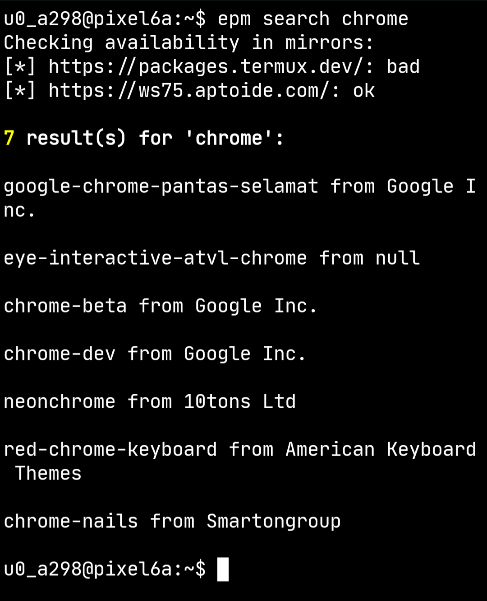

##   Enhanced Package Manager (EPM)
A solution for Android and Termux trying to bridge the gap between apk GUI apps and pkg CLI binaries into one single package manager. 
It leverages the Aptoide repos as well as the pkg backend for CLI binaries.

**Features**
- `epm install <name>` Installs an apk or pkg package by name
- `epm remove <name>` Removes an existing apk or pkg package by name
- `epm about` Shows a brief information about this project
- `epm clean` Cleans any garbadge apk files if the download process was interrupted or you want to remove the downloaded files
- `epm help` Shows the available commands and what each one does
- `epm list` Lists all apk pacakges and cli ones on the system together
- `epm search <name>` Searches for a package by that name on both Termux and Aptoide repos showing name, and provider

**Root features for GUI pacakges (apk)**
- If `epm install/remove` is called on a NON rooted device it will launch the default Android's package dialog and you would have to proceed manually
- If `epm install/remove` is called on a ROOTED device, it will leverage Android's pacakaging system `pm` for those operations

**Warnings and Precautions**
Always be careful about what you install as the Aptoide repo is not completely safe from malicious apps nor was any repo historically on other systems as well
so use responsibly and always do `epm search` to check the provider name of the package to be sure its what you want.

**Installation**
1) To install the package manager on your system, dowload the epm.sh on your termux home directory
2) Then do `chmod +x epm.sh`
3) Finally create an alias in `.bashrc` `alias epm="chmod +x /data/data/com.termux/files/home/epm.sh && /data/data/com.termux/files/home/epm.sh"`

**Screenshots**
 

