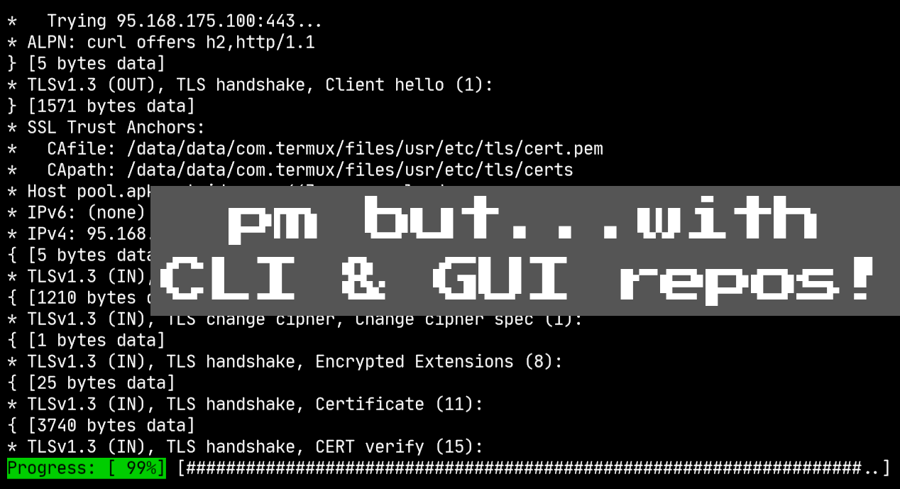
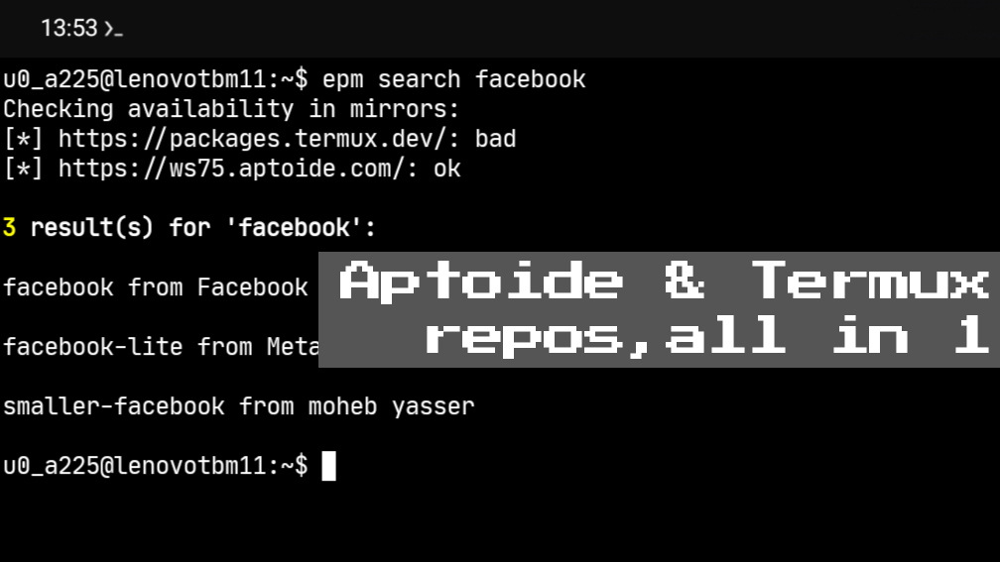
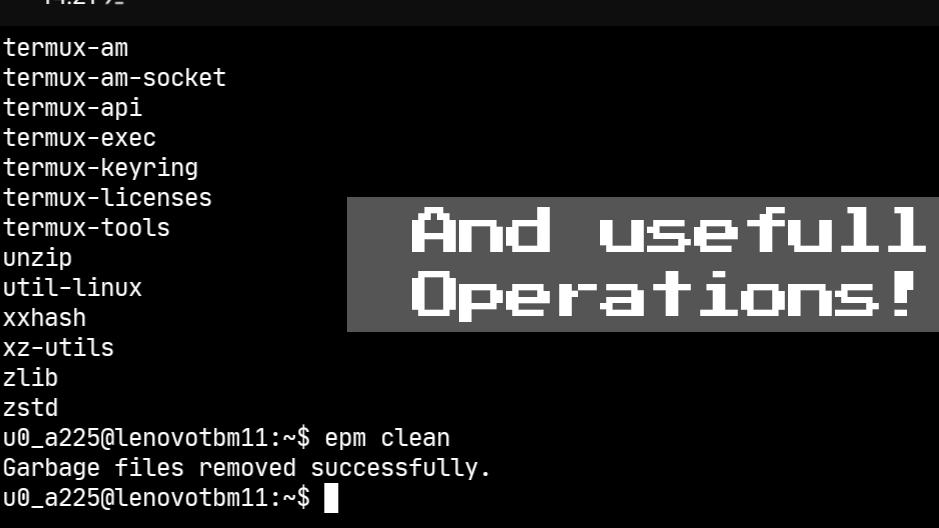

##   Enhanced Package Manager (ePM)
A solution for Android and Termux trying to bridge the gap between apk GUI apps and pkg CLI binaries into one single package manager. Built to give Android a complete package management experience, something it always lacked due to the OS restrictions. It leverages the Aptoide repos as well as the pkg backend for CLI binaries.

**Features**
- `epm install <name>` Installs an apk or pkg package by name
- `epm remove <name>` Removes an existing apk or pkg package by name
- `epm about` Shows a brief information about this project
- `epm clean` Cleans any garbadge apk files if the download process was interrupted or you want to remove the downloaded files
- `epm help` Shows the available commands and what each one does
- `epm list` Lists all apk packges and cli ones on the system together, if --showsystem it also lists system packages and apps
- `epm search <name>` Searches for a package by that name on both Termux and Aptoide repos showing name, and provider
- `epm update` Updates all cli and apk packages on the system
- Ability to use a `.pkgignore` on your termux home directory to ignore specific cli and apk packages from being updated (formatted as a list one package name per line).

**Root features for GUI pacakges (apk)**
- If `epm install/remove` is called on a NON rooted device it will launch the default Android's package dialog and you would have to proceed manually
- If `epm install/remove` is called on a ROOTED device, it will leverage Android's packaging system `pm` for those operations
- If `epm update` is called on a NON rooted system, you will only be able to a perform partial update for cli packages through pkg
- If `epm update` is performed on a rooted device, the updates will proceed normally for both cli and apk packages on the system (core android packages wont be affected, and you can always tailor the `.pkgignore` file to your needs after checking with `epm list` just to be safe) 

**Warnings and Precautions**

Always be careful about what you install as the Aptoide repo is not completely safe from malicious apps nor was any repo historically on other systems as well
so use responsibly and always do `epm search` to check the provider name of the package to be sure its what you want.

**Installation**
1) To install the package manager on your system, download the epm.sh on your termux home directory
2) Then do `chmod +x epm.sh`
3) Finally create an alias in `.bashrc` `alias epm="chmod +x /data/data/com.termux/files/home/epm.sh && /data/data/com.termux/files/home/epm.sh"`

**Screenshots**
- 
 
 

## Copyright and Licensing
Copyright © AndronikosGl 2026. All rights reserved.
This project is source-available. Modification and redistribution are not permitted. 
*Disclaimer: Enhanced Package Manager (EPM) is an independent tool and is not affiliated with, endorsed by, or officially connected to Termux or Aptoide.*
